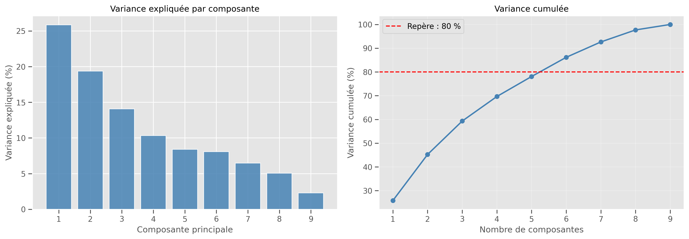
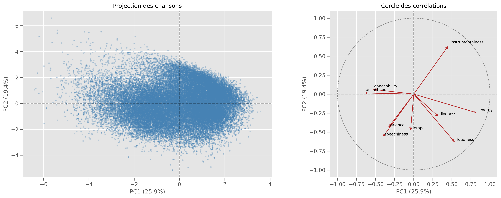
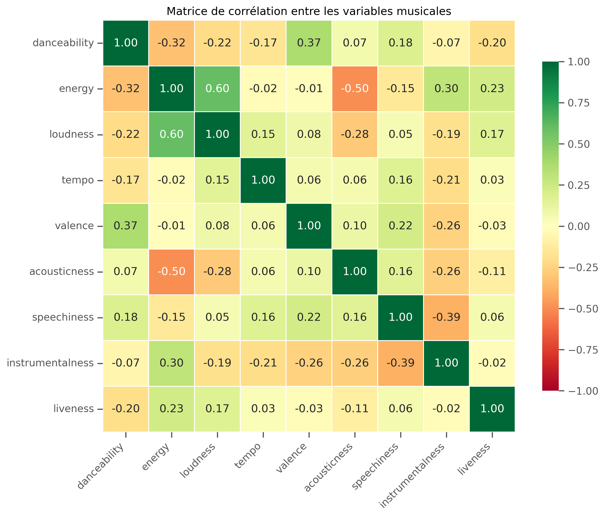
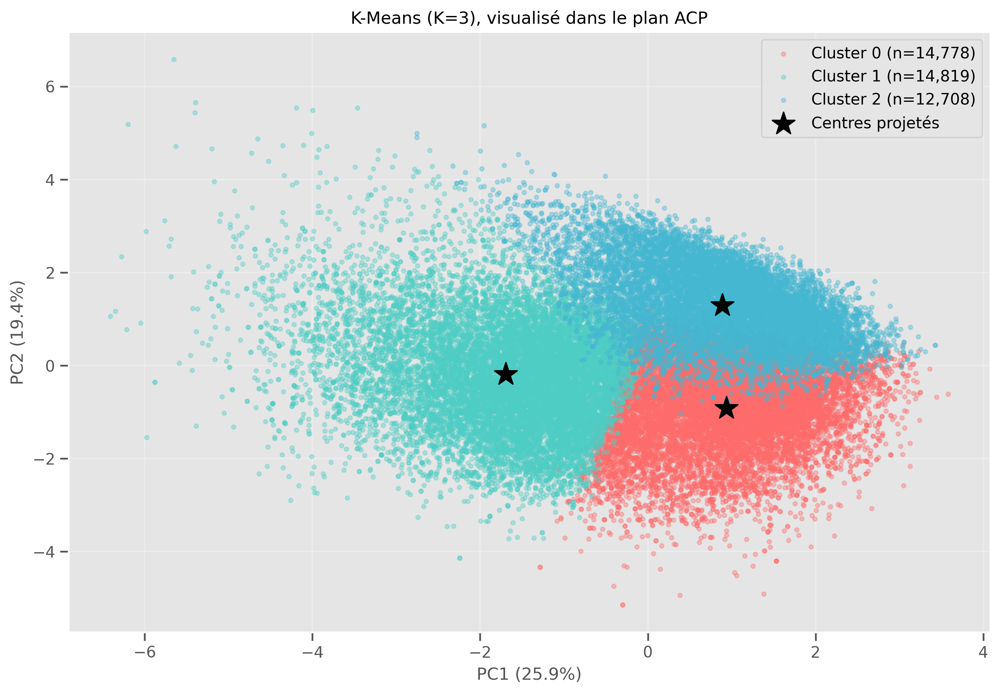
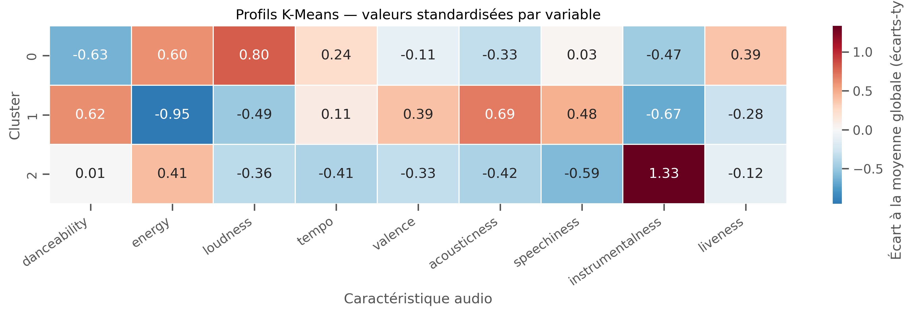
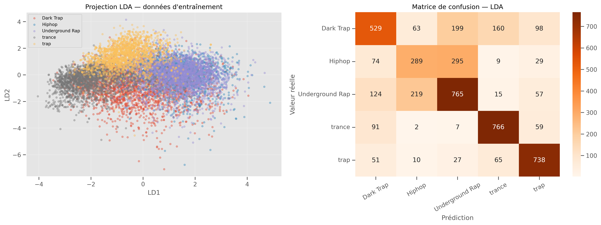
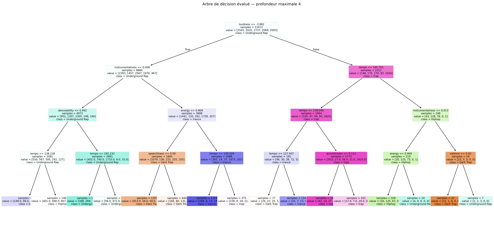

# 🎵 Analyse et classification de chansons Spotify
### Projet de Data Mining & Machine Learning

Projet académique réalisé en **Python**, consacré à l'analyse des caractéristiques audio de chansons Spotify et à l'étude des genres musicaux.

Ce projet suit les principales étapes de la méthodologie **CRISP-DM** et met en œuvre différentes techniques d'analyse exploratoire, de réduction de dimension, de clustering, de régression et de classification.

## 🎯 Objectifs

- Explorer les caractéristiques audio et la distribution des genres musicaux.
- Étudier les corrélations entre les variables musicales.
- Réduire la dimension des données avec l'**Analyse en Composantes Principales (ACP)**.
- Identifier des groupes de chansons similaires avec **K-Means**.
- Prédire le niveau sonore (`loudness`) par **régression linéaire**.
- Comparer deux modèles de classification : **LDA** et **arbre de décision**.

## 📊 Jeu de données

Le projet utilise le fichier `genres_v2.csv`, contenant :

- **42 305 enregistrements**
- **22 colonnes**
- **15 genres musicaux**

Les analyses portent notamment sur neuf caractéristiques audio :

`danceability`, `energy`, `loudness`, `tempo`, `valence`, `acousticness`, `speechiness`, `instrumentalness` et `liveness`.

**Remarque :** le dataset n'est pas inclus dans ce dépôt. Il doit être placé dans le dossier du projet avant l'exécution du notebook.

La provenance et les conditions de redistribution des données doivent être vérifiées auprès de leur source.

## 🔬 Méthodologie

Le projet s'appuie sur les principales étapes de **CRISP-DM** :

1. **Compréhension métier :** définition des objectifs d'analyse musicale.
2. **Compréhension des données :** exploration des variables, distributions et corrélations.
3. **Préparation des données :** sélection des caractéristiques, nettoyage et standardisation.
4. **Modélisation :** ACP, K-Means, régression linéaire, LDA et arbre de décision.
5. **Évaluation :** comparaison des performances et interprétation des résultats.

Il s'agit d'une étude académique hors ligne, sans phase de déploiement.

## 📈 Résultats obtenus

Les modèles ont été évalués après correction du protocole de séparation des données.

### Classification des genres musicaux

La classification porte uniquement sur les **cinq genres les plus fréquents**, et non sur les quinze genres du dataset.

| Modèle | Accuracy | F1-score macro |
|---|---:|---:|
| Analyse discriminante linéaire (LDA) | 65,1 % | 0,640 |
| Arbre de décision | 63,8 % | 0,624 |

La LDA obtient les meilleures performances parmi ces deux modèles.

### Régression linéaire

L'objectif est de prédire le niveau sonore (`loudness`) à partir des caractéristiques audio.

| Métrique | Résultat |
|---|---:|
| R² | 0,516 |
| RMSE | 2,047 dB |
| RMSE du modèle de référence | 2,943 dB |

Le modèle améliore l'erreur quadratique moyenne par rapport à une prédiction constante basée sur la moyenne de l'ensemble d'entraînement.

### Clustering K-Means

**Score de silhouette : 0,169**

Ce résultat indique une séparation relativement faible entre les clusters. Les groupes obtenus permettent néanmoins une analyse exploratoire des profils musicaux.

## 📉 Visualisations

### Analyse en composantes principales (ACP)





### Analyse des corrélations



### Segmentation K-Means





### Classification des genres





## 🛠️ Technologies utilisées

- **Langage :** Python 3.10+
- **Manipulation des données :** Pandas, NumPy
- **Visualisation :** Matplotlib, Seaborn
- **Machine Learning :** Scikit-learn
- **Environnement :** Jupyter Notebook, VS Code

## ⚙️ Installation et exécution

### 1. Cloner le dépôt

```bash
git clone https://github.com/nourbokri-hub/spotify-data-mining.git
cd spotify-data-mining
```

### 2. Créer un environnement virtuel

Dans PowerShell :

```powershell
py -3 -m venv .venv
.\.venv\Scripts\Activate.ps1
```

### 3. Installer les dépendances

```powershell
python -m pip install --upgrade pip
python -m pip install -r requirements.txt
```

### 4. Exécuter le notebook

Placez le fichier `genres_v2.csv` à la racine du projet, puis lancez :

```powershell
python -m jupyter lab
```

Ouvrez `spotify.ipynb`, sélectionnez le noyau Python de l'environnement virtuel et exécutez les cellules dans l'ordre.

Les graphiques sont générés à la racine du projet.

## 📁 Structure du projet

```text
spotify-data-mining/
│
├── spotify.ipynb
├── README.md
├── requirements.txt
├── .gitignore
│
├── acp_cercle.png
├── acp_variance.png
├── cluster_profiles.png
├── correlation.png
├── decision_tree.png
├── elbow.png
├── genre_distribution.png
├── kmeans_clusters.png
├── lda_results.png
├── regression_results.png
└── tree_results.png
```

Le fichier `genres_v2.csv` est conservé localement et exclu du dépôt GitHub.

## ⚠️ Limites du projet

- La classification concerne cinq genres musicaux sur quinze.
- Les pistes associées à plusieurs genres sont exclues de l'analyse supervisée.
- Les identifiants de pistes sont regroupés lors de la séparation entraînement/test afin de limiter les fuites de données.
- Les transformations supervisées sont ajustées uniquement sur les données d'entraînement.
- Le clustering présente une séparation limitée entre les groupes.
- Les corrélations observées n'impliquent pas de relation causale.
- Le projet ne comprend pas de système de recommandation ni de déploiement en production.

## 📌 Conclusion

Ce projet a permis d'appliquer plusieurs méthodes de **Data Mining et de Machine Learning** à des données musicales réelles.

Il illustre les différentes étapes d'un travail d'analyse de données, depuis l'exploration et le prétraitement jusqu'à la modélisation, l'évaluation et l'interprétation des résultats.
